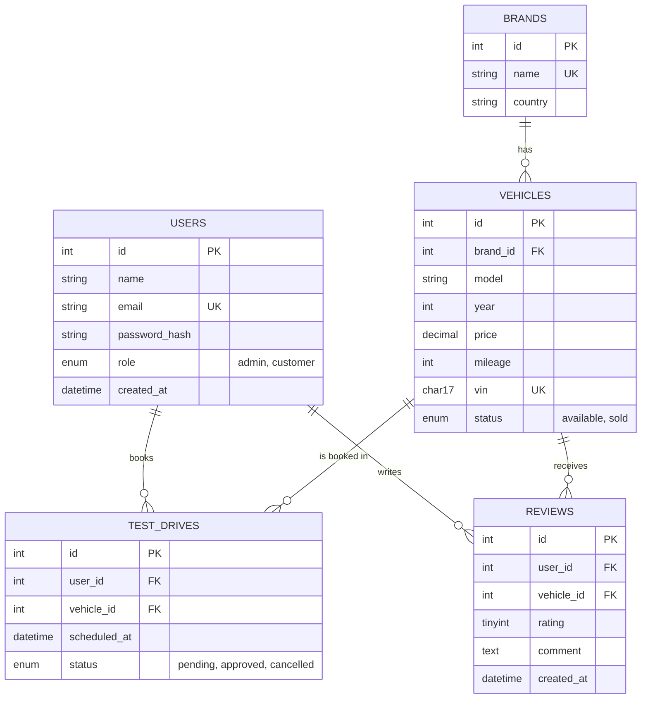

# ERD and database schema (Milestone 2)

MySQL database `redline_autos` with 5 entities. The full schema and sample data are in [database/redline_autos.sql](../database/redline_autos.sql). The picture in `ERDpicture.png` shows the same entities and relationships as the diagram below.

## Keys and delete rules

| Table | Primary key | Foreign keys | On delete of the parent |
|---|---|---|---|
| `users` | `id` | none | n/a |
| `brands` | `id` | none | n/a |
| `vehicles` | `id` | `brand_id` -> `brands.id` | RESTRICT (a brand with vehicles cannot be deleted) |
| `test_drives` | `id` | `user_id` -> `users.id`, `vehicle_id` -> `vehicles.id` | CASCADE (test drives are deleted too) |
| `reviews` | `id` | `user_id` -> `users.id`, `vehicle_id` -> `vehicles.id` | CASCADE (reviews are deleted too) |

## Other constraints

- Unique: `users.email`, `brands.name`, `vehicles.vin`.
- Check: `reviews.rating` between 1 and 5, `vehicles.year` between 1980 and 2100, `vehicles.price` >= 0 (MySQL 8.0.16 or newer enforces CHECK).
- Defaults: `users.role` = `customer`, `vehicles.status` = `available`, `test_drives.status` = `pending`, `created_at` = current time.
- All tables use InnoDB and `utf8mb4`.
